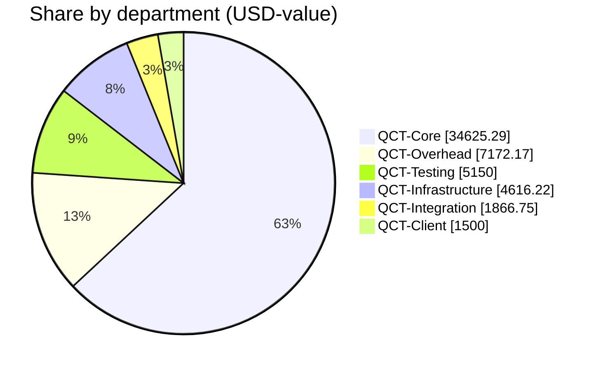
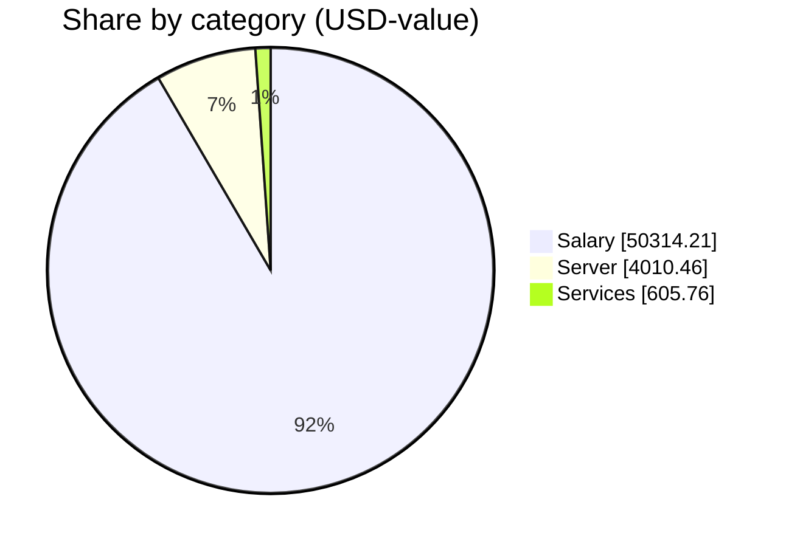

# QCT Financial Report — 2026-09

_Published by the **Qubic Core Team**. All figures are aggregated at the department level; individual amounts are private. Every treasury movement is verifiable on-chain via the transaction ids listed below._

**Status:** ✅ Finalized on 2026-10-05 21:42 UTC.

## Summary

| Metric | Value |
|---|---|
| Report month | 2026-09 |
| Payments processed | 21 |
| Departments funded | 6 |
| Total USD-value | 54,930.44 |
| Total QU sent | 97,590,946,512 |
| Total network fees | 70 QU |
| **Total QU debited from treasury** | **97,590,946,582** |

## Treasury state

Treasury address: `XQCLNHCEHTKQZDBAHJFVVTRMWFACMAZOBAEDQHEITGGEWZDIBRAIYWPGEONG`

| Metric | QU | ≈ USD (at run rates) |
|---|--:|--:|
| Balance snapshot | 847,912,983,809 | 477,259.73 |
| This run's outflow | −97,590,946,582 | −54,930.44 |

_Balance fetched 2026-10-05 21:42 UTC from `https://rpc.qubic.org`. Verify live at [rpc.qubic.org/v1/balances/XQCLNH…EONG](https://rpc.qubic.org/v1/balances/XQCLNHCEHTKQZDBAHJFVVTRMWFACMAZOBAEDQHEITGGEWZDIBRAIYWPGEONG)._

## Exchange rates applied

| Rate | Value | Notes |
|---|--:|---|
| QU per USD | 1’776’628 | 3-day average |
| USD per EUR | 1.1204 | ECB reference (Frankfurter) |
| USD per CHF | 1.2033 | ECB reference (Frankfurter) |
| USD per USDT | 1.0000 | pinned |
| USD per USDC | 1.0000 | pinned |

**Rates fetched:** 2026-10-05 21:30 UTC · **Source:** CoinGecko 3d-avg (QU/USD) + Frankfurter/ECB (EUR, CHF) — refreshed 2026-10-05; stables pinned to 1.00

Rates are frozen on the run at creation and any 'Refresh rates' click.

## Spend by department

| Department | Payments | USD-value | QU (incl. fees) | Share of run |
|---|--:|--:|--:|--:|
| QCT-Core | 5 | 34,625.29 | 61,516,253,494 | 63.0% |
| QCT-Overhead | 3 | 7,172.17 | 12,742,277,362 | 13.1% |
| QCT-Testing | 2 | 5,150.00 | 9,149,633,955 | 9.4% |
| QCT-Infrastructure | 7 | 4,616.22 | 8,201,312,147 | 8.4% |
| QCT-Integration | 3 | 1,866.75 | 3,316,527,677 | 3.4% |
| QCT-Client | 1 | 1,500.00 | 2,664,941,936 | 2.7% |

## Spend by category

| Category | Payments | USD-value | QU | Share |
|---|--:|--:|--:|--:|
| Salary | 14 | 50,314.21 | 89,389,634,376 | 91.6% |
| Server | 4 | 4,010.46 | 7,125,103,356 | 7.3% |
| Services | 3 | 605.76 | 1,076,208,781 | 1.1% |

## Network fees

| Hop | sendMany calls | Fee (QU) |
|---|--:|--:|
| Treasury → Departments | 1 | 10 |
| Departments → recipients | 6 | 60 |
| **Total** | **7** | **70** |

## On-chain transactions

Every treasury movement in this run is verifiable on-chain.

### Treasury sendMany batches (internal Treasury → Departments)

| Batch | Tx |
|---|---|
| 1 | [`vvjbsk…fwli`](https://explorer.qubic.org/network/tx/vvjbskxrndgdheumyrulddexebabsrdpcdtyziahuaadvbnnmmlfprwcfwli) |

### Department distributions (Departments → recipients)

Per-recipient identities and amounts are not disclosed; only the aggregate sendMany transaction ids per department are shown so anyone can reconcile the on-chain totals.

| Department | Recipients | sendMany calls | Tx ids |
|---|--:|--:|---|
| QCT-Client | 1 | 1 | [`vuxufu…mxlc`](https://explorer.qubic.org/network/tx/vuxufuxbizyzhgfkrwhkbfpsgtnbpvyquozknnqpggelvshfqvldllfemxlc) |
| QCT-Core | 5 | 1 | [`wvufzp…newe`](https://explorer.qubic.org/network/tx/wvufzphnyygyaaqlwgepmnympctfebgecfptuvwnecfuyqruyoytoxwenewe) |
| QCT-Infrastructure | 7 | 1 | [`wvufzp…newe`](https://explorer.qubic.org/network/tx/wvufzphnyygyaaqlwgepmnympctfebgecfptuvwnecfuyqruyoytoxwenewe) |
| QCT-Integration | 3 | 1 | [`ewyrfz…jdgd`](https://explorer.qubic.org/network/tx/ewyrfzxwpphvabjtdaqccmolydfdvxwiqwquaqyjsgsuwadlwdurnvdajdgd) |
| QCT-Overhead | 3 | 1 | [`ypdrxr…cjol`](https://explorer.qubic.org/network/tx/ypdrxrxpwyazhfrdryymnmaopruepjiyogfkhizuifqrmwnpqvyfzqrbcjol) |
| QCT-Testing | 2 | 1 | [`ennmli…aqoh`](https://explorer.qubic.org/network/tx/ennmlilbkalscbiacxupurubpjgecdzugzrwmysjjbffbpuxlmpifcnaaqoh) |

## Q3 Budget Execution Summary (Jul – Sep 2026)

With the [Q3 funding proposal](https://github.com/qubic/qct/blob/main/funding/2026-07-01-Q3-proposal.md), QCT received **671 billion QUBIC** from CCF on 2026-07-15. This amount covered Q3 operations (Jul–Sep 2026) **plus** a $35,116.28 refund for the June 2026 shortfall personally covered by @j0et0m.

### Monthly spend during Q3

| Month | USD Spent | QUBIC Spent | Rate (USD/bln) |
|-------|-----------|-------------|-----------------|
| July 2026 | $60,607.01 | 137.43B | 441 |
| August 2026 | $59,951.16 | 141.49B | 424 |
| September 2026 | $54,930.44 | 97.59B | 563 |
| **Q3 operating subtotal** | **$175,488.61** | **376.51B** | — |
| June 2026 shortfall refund (paid in Jul) | $35,116.28 | 85.23B | 412 |
| **Q3 total treasury outflow** | **$210,604.89** | **461.74B** | — |

**Observations.**
- Monthly **USD run rate declined** steadily through Q3: $60.6K → $60.0K → $54.9K. Average $58.5K/month vs. the Q3 target of ~$84.5K/month — a **~31% underspend by design** (deliberate workload reduction after the June 2026 shortfall; see the Q3 proposal).
- **QUBIC consumption dropped more steeply** than USD in September because QUBIC recovered from ~424 USD/bln (August) to ~563 USD/bln (September) — a ~33% rally that lowered the QU cost of the same USD payroll by roughly one third.

### Q3 unspent

- Q3 budget received: **671.00B QUBIC**
- Q3 total outflow: **461.74B QUBIC**
- **Q3 unspent: 209.26B QUBIC** (~31% of the Q3 allocation)

This unspent balance remained in the treasury at end of September.

## Treasury allocation forward (end of Sep 2026)

Two additional funding events landed in the treasury during September 2026:

| Event | QUBIC | Context |
|---|--:|---|
| **Base Services Reserve** — approved | +190,000,000,000 | 15-month runway for public apps + RPC + archiver + basic test-net + infrastructure, through Dec 2027. [Proposal](https://github.com/qubic/qct/blob/main/funding/2026-09-15-Base-Services-Reserve-proposal.md) |
| **Q4 2026 operational delta** — approved | +450,000,000,000 | 3-month full-team operational budget for Oct – Dec 2026 (on top of the base). [Proposal](https://github.com/qubic/qct/blob/main/funding/2026-09-15-Q4-2026-proposal.md) |

Combined with the Q3 unspent carryover and the September payment outflow, the resulting end-of-September balance is **847.91B QUBIC**:

| Component | QUBIC | Share | ≈ USD at Sep rate (563/bln) |
|-----------|------:|------:|---------------------------:|
| Earmarked — Base Services Reserve (through Dec 2027) | 190.00B | 22.4% | ~$107,000 |
| Earmarked — Q4 operational delta (Oct – Dec 2026) | 450.00B | 53.1% | ~$253,000 |
| Residual carryover (Q3 unspent, less rounding) | ~207.91B | 24.5% | ~$117,000 |
| **Total treasury balance** | **847.91B** | **100%** | **~$477,260** |

The ~208B QUBIC residual carryover acts as a buffer against QUBIC price depreciation during Q4 and provides early visibility into Q1 2027 funding needs.

## Notes

- Payment amounts are quoted in USD-value using the frozen exchange rates above.
- Recipients who prefer stables (USDT/USDC) receive QU on-chain at their contractor's wallet; the contractor converts and forwards off-chain.
- Transaction references link to the Qubic explorer.

_Generated 2026-10-05 21:42 UTC by QCT.PayOps._
