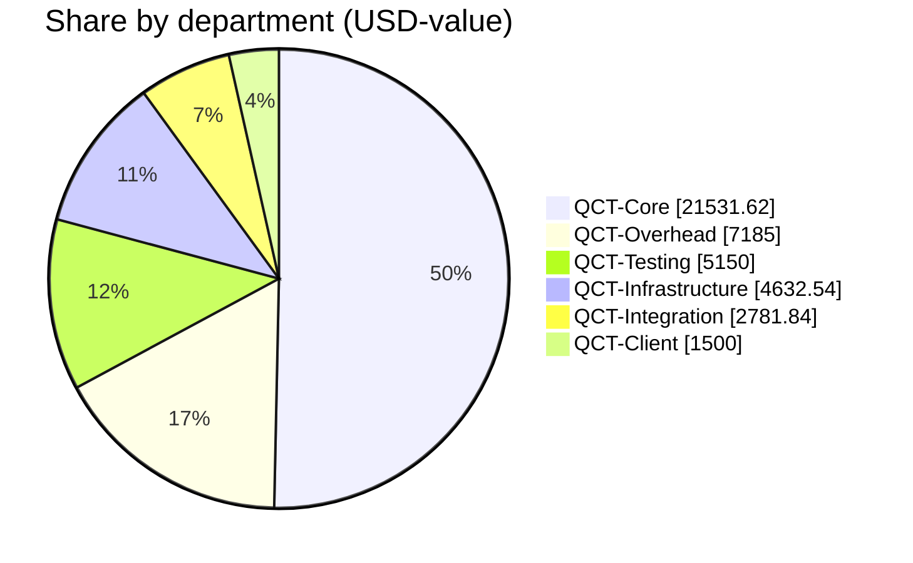
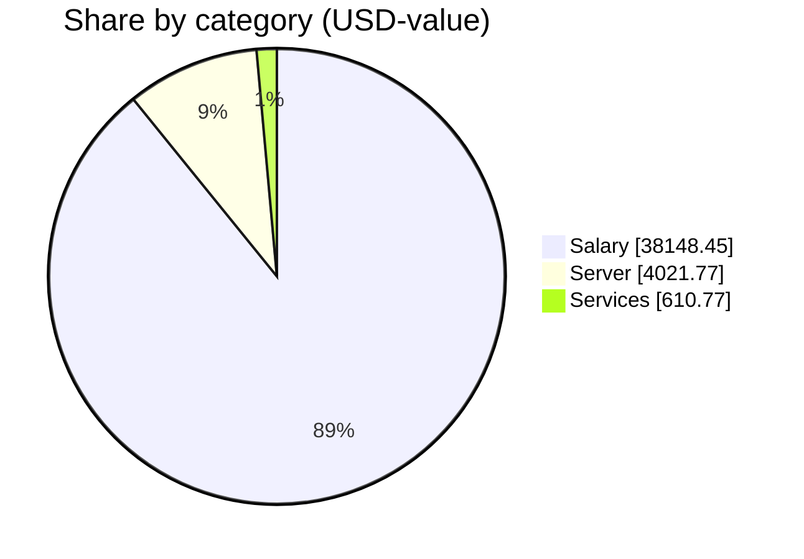

# QCT Financial Report — 2026-10

_Published by the **Qubic Core Team**. All figures are aggregated at the department level; individual amounts are private. Every treasury movement is verifiable on-chain via the transaction ids listed below._

**Status:** ✅ Finalized on 2026-11-05 10:26 UTC.

## Summary

| Metric | Value |
|---|---|
| Report month | 2026-10 |
| Payments processed | 20 |
| Departments funded | 6 |
| Total USD-value | 42,780.99 |
| Total QU sent | 103,483,271,128 |
| Total network fees | 70 QU |
| **Total QU debited from treasury** | **103,483,271,198** |

## Treasury state

Treasury address: `UAQWALORECGPEEZZQJRCRGJFXPCDEUXXMGRCPMEORCJQRSEVTHQUJJPDJUDM`

| Metric | QU | ≈ USD (at run rates) |
|---|--:|--:|
| Balance snapshot | 744,429,712,609 | 307,754.50 |
| This run's outflow | −103,483,271,198 | −42,780.99 |

_Balance fetched 2026-11-05 10:41 UTC from `https://rpc.qubic.org`. Verify live at [rpc.qubic.org/v1/balances/UAQWAL…JUDM](https://rpc.qubic.org/v1/balances/UAQWALORECGPEEZZQJRCRGJFXPCDEUXXMGRCPMEORCJQRSEVTHQUJJPDJUDM)._

## Exchange rates applied

| Rate | Value | Notes |
|---|--:|---|
| QU per USD | 2’418’908 | 3-day average |
| USD per EUR | 1.1267 | ECB reference (Frankfurter) |
| USD per CHF | 1.2263 | ECB reference (Frankfurter) |
| USD per USDT | 1.0000 | pinned |
| USD per USDC | 1.0000 | pinned |

**Rates fetched:** 2026-11-05 10:20 UTC · **Source:** CoinGecko 3d-avg (QU/USD) + Frankfurter/ECB (EUR, CHF) — refreshed 2026-11-05; stables pinned to 1.00

Rates are frozen on the run at creation and any 'Refresh rates' click.

## Spend by department

| Department | Payments | USD-value | QU (incl. fees) | Share of run |
|---|--:|--:|--:|--:|
| QCT-Core | 4 | 21,531.62 | 52,083,001,111 | 50.3% |
| QCT-Overhead | 3 | 7,185.00 | 17,379,840,102 | 16.8% |
| QCT-Testing | 2 | 5,150.00 | 12,457,374,335 | 12.0% |
| QCT-Infrastructure | 7 | 4,632.54 | 11,205,686,623 | 10.8% |
| QCT-Integration | 3 | 2,781.84 | 6,729,007,555 | 6.5% |
| QCT-Client | 1 | 1,500.00 | 3,628,361,464 | 3.5% |

## Spend by category

| Category | Payments | USD-value | QU | Share |
|---|--:|--:|--:|--:|
| Salary | 13 | 38,148.45 | 92,277,584,516 | 89.2% |
| Server | 4 | 4,021.77 | 9,728,284,811 | 9.4% |
| Services | 3 | 610.77 | 1,477,401,801 | 1.4% |

## Network fees

| Hop | sendMany calls | Fee (QU) |
|---|--:|--:|
| Treasury → Departments | 1 | 10 |
| Departments → recipients | 6 | 60 |
| **Total** | **7** | **70** |

## On-chain transactions

Every treasury movement in this run is verifiable on-chain.

### Treasury sendMany batches (internal Treasury → Departments)

| Batch | Tx |
|---|---|
| 1 | [`mdiedg…xikc`](https://explorer.qubic.org/network/tx/mdiedgqwjmaotgwhsjadfbutfwmelujnxvjuaglqcbonomekcussyqahxikc) |

### Department distributions (Departments → recipients)

Per-recipient identities and amounts are not disclosed; only the aggregate sendMany transaction ids per department are shown so anyone can reconcile the on-chain totals.

| Department | Recipients | sendMany calls | Tx ids |
|---|--:|--:|---|
| QCT-Client | 1 | 1 | [`kmjoqc…tkom`](https://explorer.qubic.org/network/tx/kmjoqcsbaslqncsduedlblnihofcbzhtkiuscgvghhhnaswmpxdkgyagtkom) |
| QCT-Core | 4 | 1 | [`yognst…spxf`](https://explorer.qubic.org/network/tx/yognstexyurvzcretoybwfbxllgdwnqbdfyssffmfdbursrkifinlfjfspxf) |
| QCT-Infrastructure | 7 | 1 | [`iplhdv…wvim`](https://explorer.qubic.org/network/tx/iplhdvhykuavpgcwrhpdzfwcxwwbiqzwxsuusrfnnbngnoukbqrozxufwvim) |
| QCT-Integration | 3 | 1 | [`lqfgqg…hasm`](https://explorer.qubic.org/network/tx/lqfgqgrnywefzbpedhzqkabbxlrdhqfmcxefyjkuqefxzfpmcdyxxwqchasm) |
| QCT-Overhead | 3 | 1 | [`uvexad…ltzm`](https://explorer.qubic.org/network/tx/uvexadnaciqxxgfqzxuugwpaatqfhpaircrhclicdhoejasbymxdtkvbltzm) |
| QCT-Testing | 2 | 1 | [`kxvrmy…kvqa`](https://explorer.qubic.org/network/tx/kxvrmygzhakxadghbtdhkcnsulehczlxftzzyggowecxjowdpxphkcqdkvqa) |

## Notes

- Payment amounts are quoted in USD-value using the frozen exchange rates above.
- Recipients who prefer stables (USDT/USDC) receive QU on-chain at their contractor's wallet; the contractor converts and forwards off-chain.
- Transaction references link to the Qubic explorer.

_Generated 2026-11-05 10:41 UTC by QCT.PayOps._
